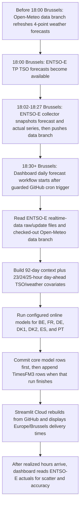

# Real-Time Load and Renewables Forecast Dashboard

Daily online forecasting dashboard for load, solar, and wind in the BE, FR, DE, DK1, DK2, ES, and PT bidding zones.

The first online version runs once per day after the daily 18:00 Europe/Brussels ENTSO-E Transparency Platform publication point. The dashboard workflow is triggered around 18:30 Europe/Brussels, after the realtime data collector has had time to snapshot and push the latest TSO forecasts; under normal conditions the new dashboard results should be visible before about 19:00. It fetches the latest TSO forecasts and Open-Meteo weather forecasts, builds the agreed feature sets from the latest 3-month context window, runs configured ML/TSFM models, stores the forecasts, and visualizes forecast tracking in Streamlit.

## What Is Included

- Streamlit dashboard with country, target, model, and issue-log views.
- Daily pipeline entrypoint for ENTSO-E and Open-Meteo ingestion.
- Four weather-point configuration per bidding zone and target type.
- Separate load, solar, onshore wind, and offshore wind targets.
- Brussels-cutoff-to-cutoff daily horizon (23/24/25 hours) with 2,208-hour rolling context.
- Pluggable model registry for existing load, solar, wind, ML, and TSFM artifacts.
- Local CSV storage for forecasts, observations, run metadata, and failures.
- Backfill command for missed dates.
- GitHub Actions workflow template for once-per-day execution.

## Quick Start

```bash
python -m venv .venv
source .venv/bin/activate
pip install -r requirements.txt
pip install -e .
cp .env.example .env
streamlit run app.py
```

Run a daily forecast locally:

```bash
python -m rt_forecast_dashboard.pipeline.run_daily --date 2026-08-07
```

Backfill missed days:

```bash
python -m rt_forecast_dashboard.pipeline.backfill --start 2026-08-01 --end 2026-08-07
```

Recovery processes the newest date first and preserves each already-complete
zone/target/model group. Use `--force` only to deliberately recompute saved runs.
The daily GitHub workflow now checks the latest eligible date by default;
operators can select `repair_recent_days: 3` or `10` in a manual dispatch for
historical recovery. Older holes are no longer retried ahead of today's results
automatically. GitHub schedule delays can still move execution past 18:30
Brussels time; that is an earliest allowed time, not a guaranteed start time.

Dashboard visits never launch forecasting jobs. The scheduled pipeline publishes
`forecast_catalog.parquet` and `probabilistic_leaderboard.parquet` alongside the
forecast/interval files. Pages read these compact snapshots, load only the
selected zone and task, and render only the selected point/probabilistic view.
Observed outcomes and derived scores refresh hourly in the background via
`refresh-results.yml` (scheduled at :15 each hour, subject to collector
availability and GitHub delays). This updates actuals, point-score tables,
probabilistic intervals and their coverage/width table without rerunning models
or refitting ensemble forecasts. Forecast inference and ensemble generation stay
in the daily workflow. Page visits no longer wait for a collector HTTP request.
A sleeping host can still have cold-start
overhead, independently of forecast scheduling.

## Credentials

Set `ENTSOE_API_KEY` in `.env` or Streamlit secrets. Without credentials, the pipeline can still create deterministic demo data so the dashboard remains testable.

## Model Artifacts

Place serialized model artifacts under `models/` and update `config/model_registry.yml`.

The initial registry uses robust baseline adapters:

- `tso_reference`: returns the ENTSO-E TSO forecast as the benchmark.
- `ridge_3mo_context`: fits a Ridge model each day on the latest 3 months using selected weather covariates plus TSO forecast.
- `chronos2_online`: runs Chronos2 with the selected 3-month context and task-specific covariates.
- `timesfm3_online`: runs TimesFM3 with the same online covariate policy as Chronos2.
- `xgboost_online`: fits compact XGBoost models for renewable targets using four-point weather plus TSO forecast.
- `artifact_model`: loads saved artifacts when paths are configured.

Load covariates follow the latest selected feature table:

| Country | Chronos2 | TimesFM3 | Ridge | TabPFN |
|---|---|---|---|---|
| BE | Solar + TSO | Solar + TSO | Temp + TSO | Temp + TSO |
| FR | Temp + TSO | Temp + TSO | deg_proxy + TSO | Temp + TSO |
| DE | Hum + TSO | Hum + TSO | Hum + TSO | Solar + TSO |

Solar uses four-point `shortwave_radiation` and `temperature_2m` plus TSO forecast. Onshore and offshore wind use four-point `wind_speed_100m_ms`, `wind_dir_sin`, and `wind_dir_cos` plus TSO forecast.

## Repository Layout

```text
app.py
config/
  zones.yml
  features.yml
  model_registry.yml
src/rt_forecast_dashboard/
  data/
  models/
  pipeline/
  ui/
data/
  forecasts/
  raw/
  issues/
  backfill/
models/
tests/
```

## Deployment Notes

For GitHub Actions, add repository secrets:

- `ENTSOE_API_KEY` for direct ENTSO-E fallback if the realtime-data archive is incomplete.
- `TABPFN_TOKEN` for TabPFN in fresh/headless GitHub Actions runners. Local runs may work without this variable when the TabPFN license/model state is already cached, but the cloud runner can need the token before it can download or initialize the model weights. TabPFN is therefore not shown in the online dashboard for now: the cloud API/environment setup is not yet stable enough for unattended daily runs, and the calculation time is materially longer than the other online models. The stored/displayed online dashboard currently prioritizes the models that can finish reliably within the daily update window.

For Streamlit Community Cloud or Hugging Face Spaces, add the same value to app secrets and mount/persist the `data/` directory if historical tracking should survive redeploys.

## Daily Update Timeline

Scheduled operation follows Europe/Brussels time. ENTSO-E and Open-Meteo API timestamps are stored and queried in UTC after converting the Brussels cutoff timestamp. During CEST, the 18:00 Brussels cutoff is `16:00 UTC`; a 24-hour hourly forecast therefore stores delivery timestamps from `16:00 UTC` through `15:00 UTC`, which display as `18:00` through `17:00` in Europe/Brussels. The last `17:00` timestamp represents the `17:00-18:00` delivery hour. Clock-change windows instead contain 25 hours in autumn and 23 in spring, ending at the next Brussels cutoff; see [DST handling and plotting checks](docs/DAYLIGHT_SAVING.md).



### Operational Map

| Stage | Repository / service | Included data | Dashboard use |
|---|---|---|---|
| ENTSO-E snapshot collection | `Energy-Data-Science/entsoe-realtime-data`, `data` branch | Forecast and actual series under `data/hourly`; compact BE/FR/DE/DK1/DK2/ES/PT comparison actuals under `data/dashboard/actuals_recent.parquet` | TSO covariate, TSO benchmark, 3-month context values, and one-request realized actuals for dashboard diagnostics |
| Open-Meteo weather collection | `XiaoyuJIN97/open-meteo-realtime-data`, `data` branch | Four-point target-specific files under `data/raw/{BE,FR,DE,DK1,DK2,ES,PT}/{load,solar,onshore,offshore}`. Load uses `temperature_2m`, `relative_humidity_2m`, `shortwave_radiation`, plus a derived degree proxy. The degree proxy is computed in the dashboard as the absolute distance between the mean four-point temperature and an 18 C comfort/reference temperature, so it summarizes heating/cooling stress with one covariate. Solar uses `shortwave_radiation` and `temperature_2m`. Wind uses `wind_speed_100m_ms`, `wind_dir_sin`, and `wind_dir_cos`. Spain does not include offshore wind because that ENTSO-E series is unavailable. | Weather covariates for load, solar, onshore wind, offshore wind |
| Daily forecast | this dashboard repo, `.github/workflows/daily-forecast.yml` | `data/forecasts/forecasts_YYYY-MM-DD.csv` with 24 hourly delivery timestamps, forecasts, TSO benchmark, run metadata, context start/end | Reads public ENTSO-E hourly archive first, falls back to raw/update files when needed, reads checked-out Open-Meteo files, and displays deterministic forecast analysis, scatter diagnostics, accuracy, and run history |
| Streamlit display | Streamlit Cloud | Live dashboard from committed forecast CSVs plus fetched realized actuals | Displays timestamps in Europe/Brussels; uses ENTSO-E actuals only for visualization/diagnostics, not as forecast inputs |

The dashboard forecast workflow is scheduled to run after about `18:30 Europe/Brussels` each day. GitHub Actions cron is UTC-only and can be delayed, so the workflow uses several UTC fallback triggers with a Brussels-time guard. Only a trigger after the Brussels forecast window proceeds when the daily forecast file is missing. This deliberately leaves a buffer after the 18:00 Brussels publication time so the ENTSO-E collector can snapshot and push the latest TSO forecasts before forecasting begins.


### T0 Gamma and Timestral online forecasts

Both use TimesFM3's covariate policy and the same 2,208-hour context / 24-hour
horizon. Checkpoints are pinned in `models/foundation_runtime.py`. The scheduled
workflow appends their predictions after TimesFM3 and before building the compact
leaderboard artifacts.

Their Hugging Face Hub dependency conflicts with the Chronos2 runtime, so they
run in persistent subprocesses in a dedicated environment:

```bash
python -m venv .foundation-env
.foundation-env/bin/pip install -r scripts/requirements-foundation-online.txt
python -m rt_forecast_dashboard.pipeline.run_daily --date YYYY-MM-DD --models t0_gamma_online,timestral_online --keep-issues
```

On Linux CPU runners, install the CPU Torch wheel from the official PyTorch CPU
index before the requirements file, as done in the workflow. `FOUNDATION_PYTHON`
overrides the isolated interpreter, `FOUNDATION_DEVICE` defaults to the configured
CPU device, and `FOUNDATION_CACHE` overrides the checkpoint cache. Dependency or
model failures become pipeline issues; they never silently return a TSO forecast.

Historical rows from the July–October rollout are explicitly labeled
`historical_mock_replay`. They reconstruct historical inputs and are not certified
issue-time vintages. Replay excludes context gaps beyond the existing quality
limits; coverage and matched comparison reports document the exclusions.

To append a validated mock export and align realized observations across models,
run `scripts/import_foundation_replay.py --replay PATH --data-dir data`, followed
by `python -m rt_forecast_dashboard.pipeline.build_dashboard_artifacts`. The
import audits every existing prediction and records revisions to shared actuals.

The rollout [results and coverage report](docs/foundation_online_since_2026-07-24/RESULTS.md) covers 108,048 mock predictions from 24 July through 19 October 2026 across the seven active zones. Both new families appear in the compact forecast artifact and daily leaderboard.

## Adding a model

Use the [standard model-onboarding pipeline](docs/model_onboarding/README.md)
and [admission PR checklist](docs/model_onboarding/PR_CHECKLIST.md). It covers
license/data review, matched 2024/2025 tests, configurable performance/resource
gates, aligned replay, ensemble qualification, live shadow, isolation and rollback.
The repository includes portable input export, a dependency-isolated runner,
admission reports, explicit publication and a GitHub PR guard. Start from
[the candidate template](examples/model_onboarding/manifest.yml); it is deliberately
not admitted. See [the policy defaults](config/model_onboarding.yml).
