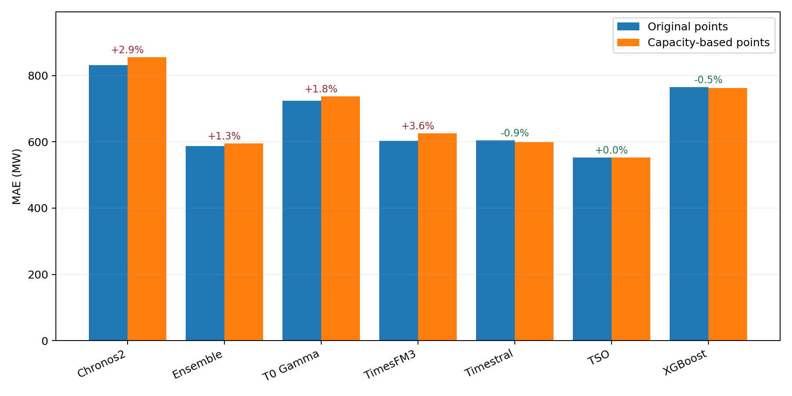
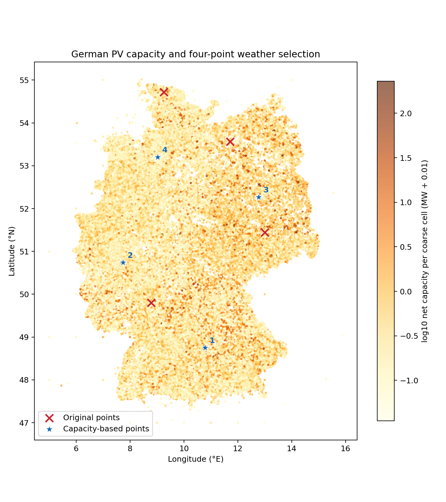

# German solar weather-point comparison — July–November 2026

Paired evaluation: **98 forecast origins**, 2026-07-24 through 2026-10-31; **2,940 hourly predictions per model**. Last delivery: 2026-11-01 22:00:00+00:00 UTC.

Only weather-point locations changed. Four points, the 2,208-hour context, 18:00 Brussels cutoff, next-day-midnight horizon, CPU model adapters/checkpoints, nine solar covariates including TSO, and the configured median ensemble were preserved. Original stored online TSO delivery curves and a common frozen actual history were used for both arms.

| Model | Original points MAE (MW) | New points MAE (MW) | Change | New/original win rate |
|---|---:|---:|---:|---:|
| TSO | 552.9 | 552.9 | +0.0% | 50.0% |
| Persistence | 2297.8 | 2297.8 | +0.0% | 50.0% |
| Chronos2 | 831.3 | 855.0 | +2.9% | 36.7% |
| TimesFM3 | 603.5 | 625.0 | +3.6% | 43.9% |
| XGBoost | 765.2 | 761.7 | -0.5% | 57.1% |
| T0 Gamma | 724.0 | 737.1 | +1.8% | 42.9% |
| Timestral | 604.0 | 598.4 | -0.9% | 52.0% |
| Ensemble | 587.6 | 595.2 | +1.3% | 51.0% |

Negative change means lower error. Win rate counts ties as half wins. The primary metric includes nighttime hours, matching the online leaderboard. Generating-hours MAE (actual >100 MW), RMSE, monthly results, and paired seven-origin block-bootstrap intervals are supplied as CSVs.

## Proposed four points

|   point |   gfs_lat |   gfs_lon |   cluster_share |
|--------:|----------:|----------:|----------------:|
|       1 |   48.75   |  10.7812  |        0.390653 |
|       2 |   50.7422 |   7.73438 |        0.226683 |
|       3 |   52.2656 |  12.7734  |        0.230836 |
|       4 |   53.2031 |   9.02344 |        0.151827 |

These points come from capacity-weighted K-means (k=4) on the full public MaStR solar inventory, including rooftop installations. Exact private coordinates were replaced by public postcode centroids where needed. Capacity shares describe selection clusters; they are not new weights applied to the forecast models.

The current-fleet and pre-period-fleet selections snapped to identical weather grids. The primary selection filters commission and registration dates to 23 July 2026. The underlying registry export is from 2 November and may contain later metadata corrections, so it is not a certified as-issued July inventory.

## Interpretation and limits

Historical Open-Meteo forecasts are stitched from short-lead model runs. Both arms use the same endpoint, automatic best-match policy, variables and retrieval method, but these are not the original day-ahead weather vintages. The paired differences isolate point selection within this reconstruction; absolute errors should not be presented as live operational performance.

Two origins without complete stored online TSO delivery curves are excluded from both arms. Actual observations are never imputed for scoring. Context repair retains the production policy and is audited in context_quality.csv. Forecast outcomes were not used to choose points.

All outputs are offline research artifacts; the online collector and dashboard point configuration were not replaced.

Sources: [MaStR / Bundesnetzagentur](https://www.marktstammdatenregister.de/MaStR/Datendownload) (Datenlizenz Deutschland – Namensnennung 2.0); [GeoNames postcode centroids](https://download.geonames.org/export/zip/) (CC BY 4.0); [Open-Meteo historical forecasts](https://open-meteo.com/en/docs/historical-forecast-api) (weather data attribution).

## Recommendation

**Do not replace the online points on the strength of this experiment.** The
capacity-based selection is more representative of the registered PV fleet,
but the ensemble MAE increases by 7.61 MW (+1.29%). Its exploratory paired 95%
interval for the MAE change is -0.40 to +15.18 MW. The ensemble's mean error also
increases in every forecast-origin month. The nominal Timestral and XGBoost
improvements are small and their paired intervals include no change.

See [reproduction instructions and required data](REPRODUCE.md),
[monthly results](monthly_metrics.csv), [interval results](interval_metrics_candidate.csv),
and [all paired predictions](paired_predictions.parquet). Seven targeted
regression tests pass; the live CPU replay completed without inference failures.
