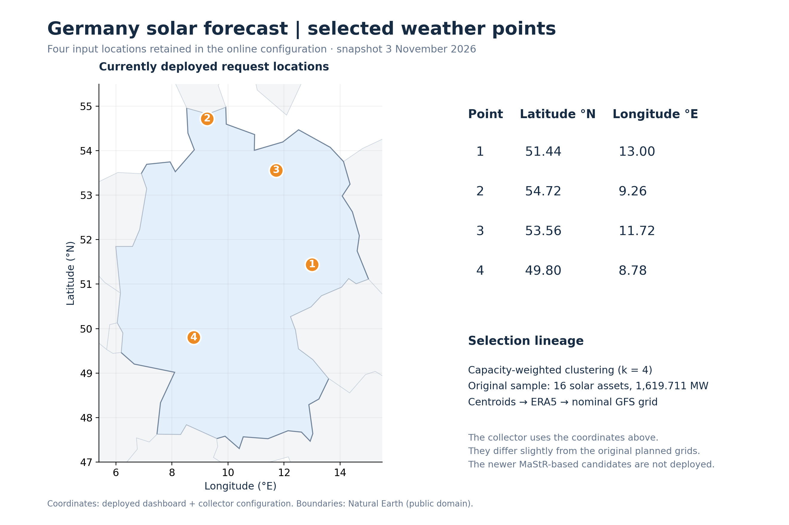
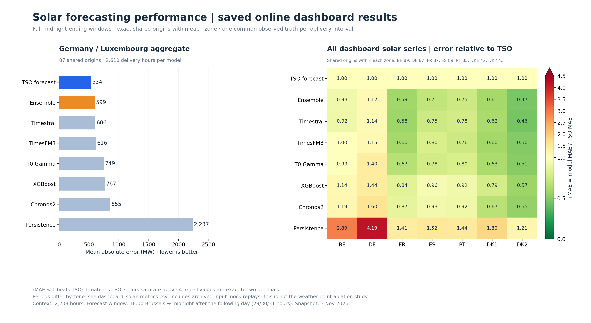
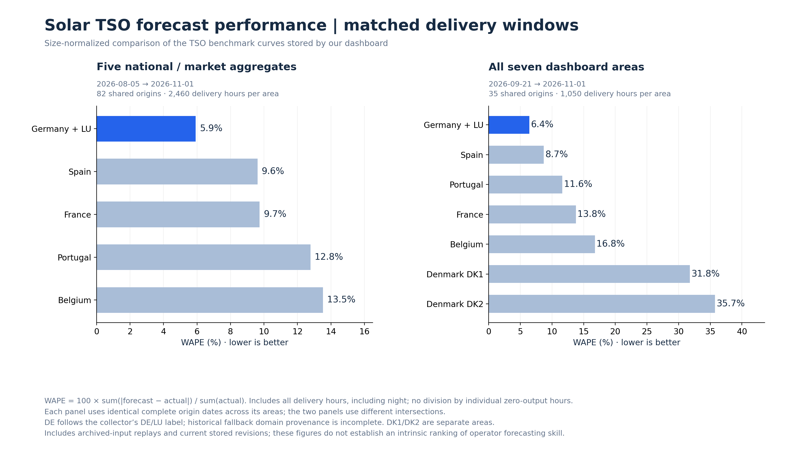

# DE solar weather points and dashboard solar performance

Snapshot: **3 November 2026**. The production weather locations are unchanged.

## The six requested deliverables

1. **Map:** [01_de_solar_weather_points_map.png](01_de_solar_weather_points_map.png).
2. **Exact coordinates:** [plain text](de_solar_weather_points.txt), [JSON](de_solar_weather_points.json), [GeoJSON](de_solar_weather_points.geojson), and [deployed configuration rows](deployed_configuration_rows.csv).
3. **Selection reference and limitations:** the provenance section below, [original selection metadata](original_selection_metadata.csv) and [notebook fingerprint](selection_provenance.json).
4. **Original selection code:** [original_point_selection.py](original_point_selection.py). This is the original algorithm, not the newer MaStR proposal.
5. **Dashboard solar performance:** [02_dashboard_solar_performance.png](02_dashboard_solar_performance.png): DE/LU absolute MAE and all seven dashboard areas' error relative to their TSO benchmark.
6. **Cross-TSO solar performance:** [03_tso_solar_performance.png](03_tso_solar_performance.png): matched-date WAPE for five national/market aggregates, plus a separate seven-area comparison including DK1/DK2.

Each figure is also supplied as vector **PDF and SVG** for presentations/publications.





## Exact currently configured weather request coordinates

| Point | Latitude (°N) | Longitude (°E) |
|---|---:|---:|
| 1 | 51.44 | 13.00 |
| 2 | 54.72 | 9.26 |
| 3 | 53.56 | 11.72 |
| 4 | 49.80 | 8.78 |

CRS: WGS84 / EPSG:4326. These decimal values are the exact request coordinates
stored in the current configuration; there is no additional hidden precision.
Open-Meteo can return the nearest available model grid cell. The `gfs_lat` /
`gfs_lon` field names do not mean that the current collector forces a GFS-only
model: the deployed request uses automatic best match.

## Reference and selection provenance

The authoritative reference for **what we run today** is the committed
[dashboard point configuration](../../config/selected_weather_points_for_tp_v01_4p.csv)
and the corresponding [weather collector configuration](https://github.com/XiaoyuJIN97/open-meteo-realtime-data/blob/main/config/selected_weather_points_for_tp_v01_4p.csv).
The collector [request code](https://github.com/XiaoyuJIN97/open-meteo-realtime-data/blob/main/scripts/fetch_open_meteo.py)
uses the selected rows' `gfs_lat` and `gfs_lon` values.

The selection methodology is recorded in the internal notebook
`Weather-one-four-points/v0.1/0_select_4p_weather_points_and_fetch_gfs.ipynb`:

- Read `renewables_metadata/renewables_location_all.csv` (solar asset coordinates and capacity).
- For Germany solar, run the notebook's deterministic capacity-weighted K-means with k = 4.
- Compute capacity-weighted cluster centroids, snap to the nearest unused 0.25° ERA5 location, then find the nearest nominal 0.1171875° GFS location using haversine distance.
- The original metadata records **16 assets and 1,619.711 MW** across the four clusters. The cluster capacity shares describe selection, not model feature weights.

The original algorithm's eight relevant functions are extracted verbatim into
`original_point_selection.py`; the wrapper makes the DE solar selection runnable
from a supplied asset CSV. The original notebook SHA-256 is recorded. The
selected centroids, original snapped coordinates, counts and capacities are
preserved in `original_selection_metadata.csv`.

**Provenance limit:** the original raw asset CSV is not available in this package,
and its upstream public publisher/license could not be verified from the
available notebook. This is an internal-method reference, not a citation to an
external publication or a complete current German PV registry. We cannot
independently regenerate the original clustering from raw assets without that
file. Nothing in the available evidence establishes that the points were
supplied directly by a colleague.

The original planned nominal GFS points (e.g. point 1 at 51.445312, 13.007812)
differ slightly from the current configured request points. Both are preserved
separately; no unverified cause for that transformation is asserted.

The [2 November full-MaStR reselection study](../de_solar_weather_points_2026-11-02/README.md)
and its [selection code](../../scripts/select_de_solar_weather_points.py) concern
**alternative candidates that were not deployed**. They should not be cited as
the origin of today's four points. Current points were retained following that
paired study's mixed results and worse ensemble mean error.

## Performance methodology and interpretation

These figures use **saved dashboard forecasts**, frozen from the production
artifact generated at **2026-11-03 08:30:22 UTC**, repository revision
`5d845f37484d34694fdd4a904cccab72f2b66806`. They do not use the paired offline
weather-point ablation predictions. The source snapshot is included as
`solar_forecasts_snapshot.parquet`; source and configuration hashes are in
`source_manifest.json`.

- Only configured dashboard areas BE, DE, FR, ES, PT, DK1, DK2 are included. NL is not enabled in the dashboard, and hidden TabPFN is excluded.
- Context is 2,208 hours. Each eligible window has the exact UTC grid from 18:00 Brussels on its origin date to midnight after the following day, exclusive: 29/30/31 hours. Incomplete windows and origins whose delivery end is after the snapshot time are excluded.
- The dashboard-model comparison uses the intersection of complete, fully observed origin dates across **all eight displayed models within each area**. Different areas consequently have different periods/counts; see `dashboard_solar_metrics.csv` and `dashboard_shared_origins.csv`.
- All models are evaluated against one common frozen actual series: the saved TSO reference row's `actual_mw` for that same area/origin/delivery instant. This avoids small model-specific differences in saved actual revisions. Forecasts are unchanged. The common scoring truth is also included.
- MAE is mean absolute error in MW. rMAE = model MAE / TSO MAE on the same windows. Values below 1 beat the benchmark. DE/LU has **87 origins, 2,610 delivery intervals**, 5 August–1 November: TSO MAE **534.16 MW**, ensemble **598.57 MW**, Timestral **606.30 MW**.
- WAPE = 100 × sum absolute error / sum actual generation. It normalizes system size without dividing by individual nighttime zero-generation hours. All delivery hours are included. This is not MAPE or capacity-normalized MAE.
- The five-aggregate TSO comparison uses **82 shared origins** (5 August–1 November, 2,460 intervals per area). The seven-area panel uses **35 shared origins** (21 September–1 November, 1,050 intervals per area). The panels must be interpreted separately; dates within each panel are identical, while missing origins are explicitly absent from its origin list.
- DE follows the preferred collector's **Germany/Luxembourg aggregate** label, not an individual German TSO. A prior domain audit identified a Germany-only direct API fallback; the saved forecast artifact does not contain per-row EIC provenance, so uniform DE/LU coverage cannot be independently certified for every historical fallback row. DK1/DK2 are separate areas. Larger geographic aggregation can smooth forecast errors, so these data do not by themselves establish an intrinsic operator skill ranking.
- Saved history includes `historical_mock_replay`, `historical_mock_ensemble` and `online` provenance. Historical reconstructed inputs/current stored revisions are not certified as-issued forecast vintages. Results are not a purely prospective operational trial.
- Overlapping delivery hours remain separate forecasts from separate origins during scoring. No outcomes are supplied to the forecasting models by this analysis.

## Reproduce

From the repository root at the recorded revision (or this package's PR revision):

```sh
PYTHONPATH=src MPLCONFIGDIR=/tmp/mpl-solar python scripts/build_solar_forecast_package.py
```

The builder needs pandas, numpy, matplotlib and a parquet engine (pyarrow).
The frozen input snapshot, nearby public-domain country boundaries, point JSON,
origin lists, metric tables, code and hashes are included. No upstream API calls
or model inference are needed to rebuild the figures.

To execute the **original** clustering, supply the original asset metadata:

```sh
python docs/solar_forecast_package_2026-11-03/original_point_selection.py \
  --metadata /path/to/renewables_location_all.csv \
  --output /path/to/original_de_solar_selection.csv
```

Map outlines: [Natural Earth country boundaries](https://www.naturalearthdata.com/downloads/110m-cultural-vectors/),
[public-domain dataset and GeoJSON](https://github.com/nvkelso/natural-earth-vector).
